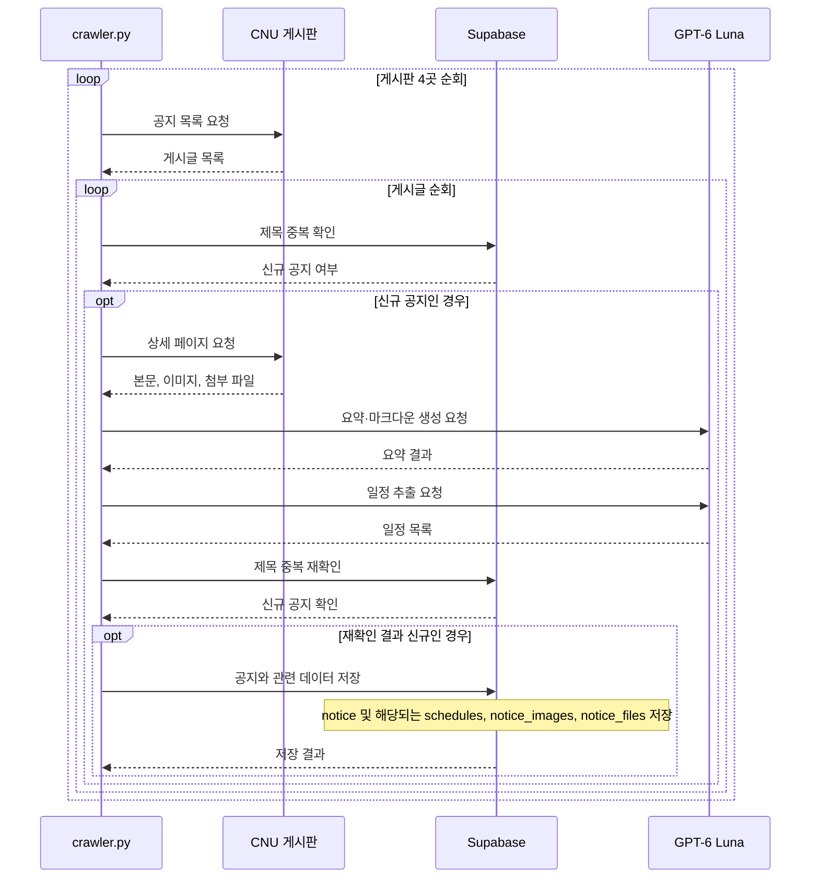

# CSE Carrier

충남대학교 컴퓨터융합학부 공지사항을 모아 요약하고 중요한 일정을 추출해 저장하고 알림을 보내는 크롤러입니다. 여러 게시판을 직접 확인해야 하는 번거로움을 줄이기 위해 만들었습니다.

## 처리 흐름

GitHub Actions가 하루 8회(한국 시간 07:00~21:00, 2시간 간격) 크롤러를 실행합니다. 크롤러는 학사, 일반, 프로젝트, 학부 공지 게시판을 확인하고 이미 처리한 공지는 건너뜁니다.

새 공지는 상세 페이지에서 본문, 이미지, 첨부 파일을 추출합니다. GPT-6 Luna가 공지 요약과 마크다운을 만들고 신청·제출 등의 일정을 구조화합니다. 결과는 Supabase에 저장하고 요약은 활성화된 Discord 웹훅으로 보냅니다.



## 구성

- `crawler.py`: 게시판 수집, 중복 확인, 처리 흐름과 Discord 알림
- `board.py`: 공지 본문, 작성자, 이미지, 첨부 파일 파싱
- `gpt_client.py`: GPT-6 Luna로 공지 요약 및 일정 추출
- `database.py`: Supabase 조회 및 저장
- `models.py`: 공지, 일정, 이미지, 파일, 웹훅 데이터 모델

## Supabase 테이블

- `notice`: 원문, 요약, 카테고리 등 공지 기본 정보
- `schedules`: 공지에서 추출한 일정
- `notice_images`: 공지 이미지 URL
- `notice_files`: 공지 첨부 파일 정보와 다운로드 URL
- `webhooks`: Discord 웹훅 주소와 활성화 상태. 알림 대상 조회에 사용합니다.

## 실행 설정

Python 3.11에서 의존성을 설치한 뒤 `crawler.py`를 실행합니다. 다음 환경 변수가 필요합니다.

- `OPENAI_API_KEY`
- `SUPABASE_URL`
- `SUPABASE_KEY`
- `DISCORD_ADMIN_WEBHOOK_URL` (선택)

```bash
pip install -r requirements.txt
python crawler.py
```
